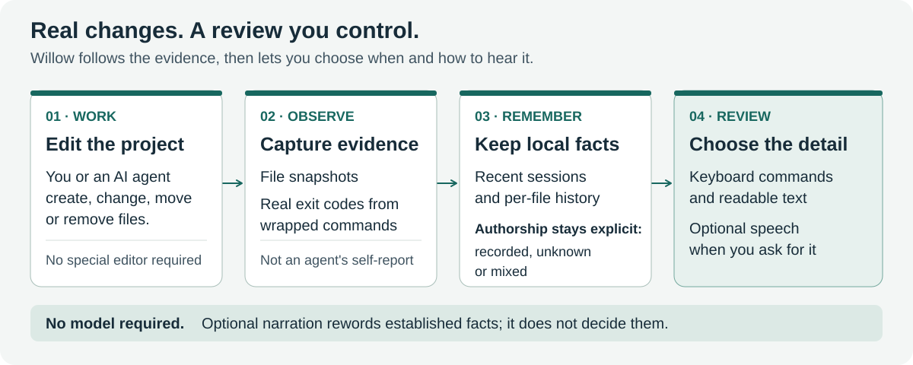
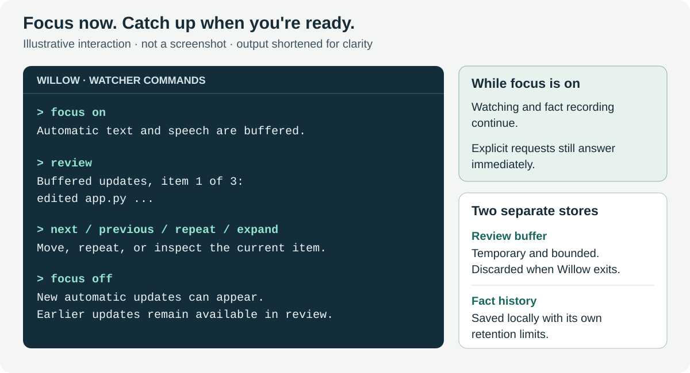

# Willow

**Follow your coding project, review changes on your terms, and return with context.**

Willow is a companion for blind developers working with AI coding agents. It
watches your project and reports file changes, real build and test outcomes,
and what changed while you were away. Use readable terminal text, optional
speech, or a focus mode that waits until you ask for an update.

The core works on **Windows, macOS and Linux**, uses only Python's standard
library, and needs no AI account or Git. Recorded authorship, inferred moves,
personal notes and optional visual interpretations are labelled explicitly.



**The workflow in words:** you and your agent work in a project; Willow observes
file changes and captures command exit codes; local memory keeps the evidence;
you choose when and how to review it. A model is optional, and an agent's
description of its work is never enough to establish a test result or authorship.

## Find your way

- [Get started](#get-started)
- [Know what changed](#know-what-changed)
- [Return after a break](#return-after-a-break)
- [Control text and speech](#control-text-and-speech)
- [Browse changes with the keyboard](#browse-changes-with-the-keyboard)
- [Check results and their freshness](#check-results-and-their-freshness)
- [Leave yourself a handover](#leave-yourself-a-handover)
- [Platforms and screen readers](#platforms-and-screen-readers)
- [Coding agents and optional AI](#coding-agents-and-optional-ai)
- [Opt-in study recording](#opt-in-study-recording)
- [Command reference](#command-reference)
- [Settings and local data](#settings-and-local-data)
- [Development and research](#development-and-research)

## Get started

You need **Python 3.8 or newer**; see the [validation notes](docs/VALIDATION.md)
for the interpreters and packaging tools checked for this build. For step-by-step
virtual-environment installation with NVDA, JAWS, VoiceOver or Orca, follow the
[screen-reader setup guide](docs/SETUP.md).

Install this checkout into your chosen Python environment from the Willow folder:

```sh
python -m pip install .
```

The package name is `willow-narrator`; a package-index release may lag this
checkout. You can also use the single `willow.py` file without installing a
package: replace `willow` below with `python /path/to/willow.py`. On systems
where Python is named `python3`, use that command instead.

### Terminal 1: set up and watch your project

Move into your project folder, then run:

```sh
willow init --no-voice
willow doctor --no-voice
willow watch --no-voice
```

Wait for the line beginning **"watching"** before editing. Keep this terminal
open. `--no-voice` keeps Willow text-only so you can use your screen reader's
usual terminal review commands. Omit it to request Willow's own speech.

Setup preserves existing settings and agent instructions, adds `.willow/` to
`.gitignore`, and merges project-local Claude Code and Codex hooks. Choose
`--agent claude` or `--agent codex` if you use only one; the default is `both`.
Use `--no-hooks` for instructions without hooks. Codex users must review and
trust the new definitions in `/hooks`; see [agent setup](docs/OPENAI.md).

### Terminal 2: work and run checks

Work with your agent as usual. Run builds and tests through Willow, from the
project folder, so it captures the command's actual exit code:

```sh
willow run npm test
```

For a Python project, for example:

```sh
willow run python -m unittest discover
```

The command's output stays in this terminal. The watcher records the result
and presents it according to your speech and focus settings. A command that
cannot launch is reported as unable to run, rather than as a failing test.
If no watcher is listening, Willow warns you and records the result locally.

In the watcher, press **Enter** for state, type `help` for commands, or `q` to
save the final checkpoint and quit.

## Know what changed

Willow groups activity into **episodes** ending at a natural pause or a command
result. It reports created, removed and edited files, line-change counts where
available, repeated editing, and observed returns to earlier content. When a
hook supplies actual write events, it can count writes; polling alone reports
repeated changes without inventing an edit count.

Failures come before routine file changes. Repeated failing attempts involving
the same command and file produce an explicitly counted warning; they do not
establish which file caused the failure or who made an unknown edit.

Persistent memory adds three kinds of change awareness:

| Change type | What Willow can report |
|---|---|
| Presence | A file or tracked dependency appeared or was removed |
| Attributes | A file changed, or a tracked setting, dependency version or project attribute changed |
| Location | A unique identical-content match suggests a move, explicitly labelled as inferred |

JSON settings, npm manifests, Python project metadata and requirements files
have structured tracking. Other formats still have file-level tracking.
Ambiguous move matches stay separate additions and removals.

Illustrative excerpts from a return briefing:

```text
Willow: src/legacy.py removed; author unknown. Evidence 12.
Willow: setting theme modified in settings.json; agent (recorded). Evidence 13.
Willow: old.py moved to new.py (identical content; inferred move); author unknown. Evidence 14.
```

### Authorship you can inspect

Each file change carries recorded user/agent activity, mixed provenance, or
**author unknown**. Hook evidence is matched to content hashes; a stale hook
cannot claim a later edit. Git author names do not establish human or AI origin,
and a matching observation does not prove exclusive authorship during concurrent
editing.

You can explicitly declare a change from the project terminal:

```sh
willow record --actor user src/example.py
```

`--actor agent` is also available. Declarations apply only to matching content
and remain labelled as declarations in the evidence. Use `evidence NUMBER`
inside the watcher to inspect a fact's source, category, authorship and hashes.

## Return after a break

The first watch establishes a baseline. Later starts compare the project with
the previous saved checkpoint and offer a **"since you were last here"** briefing.
By default it presents the first five changes, with evidence numbers. Ask for
`briefing all` to hear/read the rest.

For an interruption while the watcher stays open, type:

```text
away
```

Willow saves a break baseline and pauses automatic speech while continuing to
observe. When you return, type `back` for the net changes during that break;
the previous speech mode is restored. A second `away` preserves the original
baseline. Use `briefing` to repeat the saved return briefing.

Memory has two layers: recent session checkpoints and a longer per-file fact
history. The startup briefing covers the gap after the preceding checkpoint;
changes already recorded during that earlier session remain in history. An
unclean exit, changed Git branch or unreadable paths are reported explicitly.
An unreadable file is not treated as a verified deletion.

You can inspect memory without starting a watcher:

```sh
willow briefing --all --folder "/path/to/project"
willow history src/example.py --folder "/path/to/project"
willow evidence 12 --folder "/path/to/project"
```

Add `--json` for structured output. Standalone `willow briefing` compares now
against the last checkpoint without advancing it or assigning new evidence
numbers. Inside the watcher, `briefing` repeats its saved return comparison.

## Control text and speech

Choose the amount of interruption that suits your work:

| Mode | Start with | Automatic updates |
|---|---|---|
| Text only | `willow watch --no-voice` | Readable terminal text; no Willow speech |
| Speech on demand (default) | `willow watch` | Text; requested answers and startup information can speak |
| Automatic speech | `willow watch --speech auto` | Text and speech at episode boundaries |
| Focus | `willow watch --focus` | Automatic text and speech buffered until requested |

Combine `--focus` and `--no-voice` for a quiet watcher terminal with text-only
review. Focus also buffers automatic return briefings, results and notes at
startup; the startup instructions still explain that it is on.



**The focus workflow in words:** type `focus on`, keep working, and request
`review` when ready. Observation and factual memory continue, including for
failures and warnings. Explicit questions still answer immediately. Type
`focus off` to allow new automatic output; older buffered updates stay available
without being dumped into the terminal. This controls the watcher, not the
output in your separate command terminal.

`focus status` reports the mode and buffer size. The temporary buffer defaults
to **200 updates**, reports overflow at review, and disappears when the watcher
closes. `review clear` clears that buffer while keeping retained facts and logs.

`pause` selects on-demand speech while leaving automatic text visible; `resume`
enables automatic speech. `quiet` filters routine automatic speech and `loud`
restores it. Routine repeated speech is filtered within 15 seconds by default.
`stop` cancels speech and clears its queue. A typed request takes priority over
an old speech backlog. `faster` and `slower` adjust the system voice; NVDA/JAWS
bridge users change the rate in their screen reader's own settings.

Willow does not detect when your screen reader is speaking. These controls let
you choose the timing; native screen-reader overlap still needs device testing.

## Browse changes with the keyboard

Open a list in the watcher, then move through it one item at a time:

| Open a list | Contents |
|---|---|
| `review` | A snapshot of the currently buffered updates |
| `browse` | Up to 100 newest retained change facts |
| `history PATH` | Up to 20 retained facts for one file, following inferred moves |
| `briefing` | The saved return changes; `briefing all` also presents the full briefing |

Use `next`, `previous`, `repeat` and `expand`. Willow announces the item number
and list length. `expand` reads an update's details or the current fact's
evidence. Lists do not wrap at either end. New updates do not move your place
in a buffered review; run `review` again to include them. Filenames after
`history` may contain spaces. Use `other`, rather than `next`, to switch visual
description windows.

## Check results and their freshness

A passing command describes one observed run. It does not establish that later
edits were tested. `willow run` observes file hashes and Git context before and
after the command; the watcher retains up to **20 results**. Type `checks` for
the latest or `checks all` for all retained results. Startup and state requests
also report the latest result.

| Observed state | What the result means |
|---|---|
| Both command endpoints and now match | Observed project state matches; test coverage is not established |
| Now differs from the recorded endpoint | The result belongs to a different observed state |
| Files changed during the command | The tested version is uncertain, even if the command passed |
| Endpoint observations missing or unreadable | The version was not recorded or could not be verified |

These comparisons respect Willow's ignored directories and observation limits.
They do not cover ignored or external dependencies, prove which code was
exercised, or detect temporary edits restored between snapshots. The actual
exit code and the freshness statement remain separate.

## Leave yourself a handover

Save the context that file changes cannot tell you. In the watcher:

```text
note working Fixing keyboard navigation in the sign-in form
note blockers Waiting for the test fixture
note next Check tab order, then rerun the tests
```

Type `note` to read the three fields. Each is labelled **"User note (not
verified)"**, returns at startup, and can be up to 4,000 characters. Clear one
with `note clear blockers`, or all three with `note clear`.

Without a watcher, for example:

```sh
willow handover --folder "/path/to/project" --next "Check tab order"
```

`willow handover` reads notes; `--working`, `--blockers` and `--next` set fields;
`--clear` removes them. Notes are plain text in `.willow/handover.json`. Their
text stays out of verified fact history, model narration, announcement logs
and study exports.

## Platforms and screen readers

All factual memory, review, notes, result and study features use the same
keyboard command interface across the three platforms.

| Platform | Text and optional speech |
|---|---|
| Windows | Terminal text; system speech; optional NVDA controller or installed JAWS COM bridge |
| macOS | Terminal text with your usual VoiceOver commands; optional native `say` speech |
| Linux | Terminal text with your usual screen-reader commands; optional `spd-say`, falling back to `espeak` |

NVDA needs an architecture-matched controller client DLL supplied by the user:
`--backend nvda --nvda-dll PATH`. For installed, running JAWS, use
`--backend jaws`. Unavailable bridges report their system-speech fallback.
Linux speech requires Speech Dispatcher or eSpeak to be installed; text-only
use needs neither. Native system speech is a separate voice from VoiceOver or
Orca, rather than part of their reading queue.

See [platform installation and speech setup](docs/SETUP.md) for exact steps.
Automated backend checks do not establish real NVDA, JAWS, VoiceOver, Orca or
braille usability. **Automatic screen capture for `describe` is Windows-only.**

## Coding agents and optional AI

### Claude Code, Codex and other agents

File watching works independently of your agent. Claude Code hooks can report
write events, available command exit codes and lifecycle notifications. Codex
hooks observe matching patch endpoints, available exit codes, permission
requests and turn completion. Missing evidence, uninstrumented shell edits and
agent prose do not become verified authorship or pass/fail claims.

For another agent, use `willow init --no-hooks` and ask it to run checks through
`willow run`. Scripts and CI can also put known outcomes in
`.willow/results.txt`, such as `PASS npm test` or `1 pytest`. Those entries
have no recorded endpoint version unless separately supplied.

### OpenAI and other model backends

Models are optional for narration and visual descriptions. **Briefings, file
history, evidence and the default authorship-labelled live changes use fixed
wording**, even when narration is enabled.

| Backend | Select it with | Credentials or service |
|---|---|---|
| OpenAI | `--provider openai` | `OPENAI_API_KEY` or `~/.willow/openai_key` |
| Anthropic | `--provider anthropic` | `ANTHROPIC_API_KEY` or `~/.willow/anthropic_key` |
| Local Ollama | `--provider ollama` | A running local server with appropriate models installed |
| Compatible server | `--provider openai-compat --base-url URL` | A server supporting the required Chat Completions interface |
| No model | `--provider none` | None; factual features remain available |

For example, after setting your OpenAI key outside the project:

```sh
willow watch --provider openai --narrate
```

Direct OpenAI requests use **Responses** by default; select
`--openai-api chat-completions` for the legacy interface. Compatible servers use
Chat Completions. `--model NAME` and `--vision-model NAME` select models. No
OpenAI SDK or other third-party Python runtime package is needed. See the
[OpenAI and Codex guide](docs/OPENAI.md) for setup, trust and evidence details.

Optional legacy narration rewords eligible factual lines within a 1.5-second
budget. Syntactic checks reject unsupported numbers, paths and verdict tokens;
unavailable, rejected or late responses fall back to plain wording. These
checks do not prove semantic faithfulness. Narration receives announcement
text, which can include paths and command details.

### On-demand visual description

On Windows, open your app in a browser and type `describe` in the watcher.
Willow identifies the captured window before offering a model's description,
clearly labelled as an **interpretation**. If it selected the wrong window,
type `other`. An unavailable window, capture or suitable model produces an
unavailable-description message.

This feature sends a screenshot to the configured provider. A local server can
keep model processing on your machine; a remote provider receives the requested
data. Core factual use needs neither narration nor screen descriptions.

## Opt-in study recording

Willow includes tools for studying change awareness and listening effort.
Recording is **off by default**, uploads nothing, and starts only with an
explicit participant code:

```text
study start P01
study mark setup
study mark task-A
study mark break
study mark return
study collision
study stop
study export
```

Use approved consent procedures and participant codes rather than names. The
separate ledger records restricted action names, counts, relative timings,
phase markers and user-reported speech collisions. Speech requests are not
proof of audible delivery, and phase timing does not establish task accuracy.

`study status` reports recording state. Recording continues across watcher
restarts until **`study stop`**; ordinary `stop` only cancels speech. Active
recording is announced at startup. `study export` writes the latest session to
`.willow/study-export.json`; add a path to choose another destination.

The export excludes source, file paths/hashes, command arguments, notes and
announcement text. It retains participant codes, generated session IDs and
relative timings, so it still needs appropriate handling. Raw project logs
do not have the export's redaction. Standalone commands also work, for example
`willow study status --folder PATH`. See the [study protocol](docs/STUDY.md) for
allowed phases, selected-session exports, retention and evaluation design.

## Command reference

Type these in the **watcher** and press Enter:

| Command | Purpose |
|---|---|
| Enter or `state` | Current session state and latest retained result |
| `diff` / `recap` | Last episode's changes / whole-session summary |
| `briefing` / `briefing all` | Saved return briefing / full detail |
| `away` / `back` | Mark a break / compare with that baseline |
| `review` / `review clear` | Browse buffered updates / clear only the buffer |
| `browse` / `history PATH` | Browse retained changes / one file's history |
| `next` / `previous` / `repeat` / `expand` | Navigate and inspect the active list |
| `evidence NUMBER` | Inspect the current retained evidence for a fact |
| `checks` / `checks all` | Latest / all retained results and freshness |
| `focus on` / `focus off` / `focus status` | Control automatic text and speech buffering |
| `pause` / `resume` | On-demand / automatic speech |
| `quiet` / `loud` | Filter / restore routine automatic speech |
| `stop` | Cancel speech and its queue; alias `shh` |
| `faster` / `slower` | Change the system speech rate |
| `note` / `note FIELD TEXT` / `note clear [FIELD]` | Read, set or clear handover notes |
| `study start CODE` / `study stop` / `study status` | Control opt-in recording |
| `study mark PHASE` / `study collision` / `study export [PATH]` | Mark a phase, report overlap, export metrics |
| `describe` / `other` | Request a visual interpretation / try another window |
| `help` / `q` | List commands / checkpoint and quit |

From another terminal, use `willow init`, `watch`, `run`, `doctor`, `briefing`,
`history`, `evidence`, `record`, `handover` or `study`. Run `willow --help` or
`willow COMMAND --help` for options (`run` expects the command to execute).

## Settings and local data

Project settings live in `.willow/config.json`; shared settings live in
`~/.willow/config.json`. For example:

```json
{
  "voice": false,
  "speech_mode": "on-demand",
  "focus": true,
  "focus_buffer_limit": 200,
  "briefing_limit": 5,
  "repeat_seconds": 15,
  "memory_sessions": 30,
  "memory_facts": 10000,
  "provider": "none"
}
```

Command-line flags override environment variables, which override project
settings, shared settings and defaults. Environment overrides include
`WILLOW_PROVIDER`, `WILLOW_BASE_URL`, `WILLOW_TEXT_MODEL`, `WILLOW_VISION_MODEL`,
`WILLOW_VOICE_RATE` and `WILLOW_VERBOSITY`. `WILLOW_DIR` can explicitly route
command/hook results to a watcher's workspace. Voice rate ranges from -10 to 10;
the default is 3. Interactive mode changes last for the current watcher unless
you save the corresponding settings.

| Local data | Contents and lifecycle |
|---|---|
| `memory.sqlite3` | Default 30 recent sessions and 10,000 facts; hashes and structured fingerprints, plus up to 20 command-result records |
| `handover.json` | Your three plain-text note fields, until changed or cleared |
| `willow.log` | Announcement log, rotating at about 2 MB by default |
| `events.jsonl` / `inbox.jsonl` | Structured events / incoming results; grow until manually removed with the watcher stopped |
| `study.sqlite3` | Created only on opt-in; recording and retention managed separately |
| Focus review buffer | Up to 200 updates by default, held in RAM until cleared or the watcher exits |

These files are inside the project's `.willow/` directory. Memory snapshots
retain hashes and setting fingerprints rather than source text or setting
values. Existing diff features hold source text in RAM and print it on request.
Command lines, failure text and raw logs may contain sensitive information;
private credential filename filtering cannot identify every secret.

Willow ignores common dependency/build folders, its own workspace, symlinks
and configured exclusions; Git-based ignore discovery supplements this when
available. `extra_ignore_dirs` adds directory names. `--no-memory` disables the
session ledger without deleting earlier data; logs are separate. Retention
prunes records logically, not by secure erasure. Stop the watcher before
backing up or removing its data. Removing all of `.willow/` also removes settings
and notes. Core operation uploads no telemetry; optional remote model calls
send their requested text or screenshots to the selected provider.

If something seems silent or unavailable, run `willow doctor --no-voice` for a
readable check. For an audible request, enable `voice` in settings and omit
`--no-voice`. It checks setup,
watcher status, model configuration and speech availability; actual audible
output and screen-reader interaction still need a person to confirm them.

## Development and research

Willow 2.1 adapts change categories, recent-session memory and object-centred
history from [StateScribe](https://arxiv.org/abs/2604.23749) to coding projects.
Its evidence comes from filesystem observations and instrumented events;
StateScribe's results are not evidence of Willow's effectiveness.

From this checkout, run every build, test and technical evaluation through Willow:

```sh
python willow.py run python -m unittest discover
python willow.py run python evaluate_memory.py --output .willow/evaluation.json
python willow.py run python -m build
```

The build command needs the development build frontend (`python -m pip install
build`); Willow's runtime still has no third-party Python dependencies.

The [validation report](docs/VALIDATION.md) records 269 passing regression tests
on local Windows Python 3.12–3.15, package checks and a real-process installed
watcher session. CI covers Python 3.10–3.15 on Windows, macOS and Linux, plus
Python 3.8/3.9 on Linux; current job results are available in
[GitHub Actions](https://github.com/blindwikan/willow/actions).

The synthetic evaluator measures facts, repetition, timing and storage across
explicit fixtures and 110 revisits. It is not a participant study. Independent
installation, native screen-reader/braille acceptance, real agent sessions and
participant evaluation remain necessary before usability claims.

Further reading: [behavior rulebook](RULES.md), [accessible setup](docs/SETUP.md),
[OpenAI and Codex](docs/OPENAI.md), [implementation notes](docs/IMPLEMENTATION.md),
and [research protocol](docs/STUDY.md).
